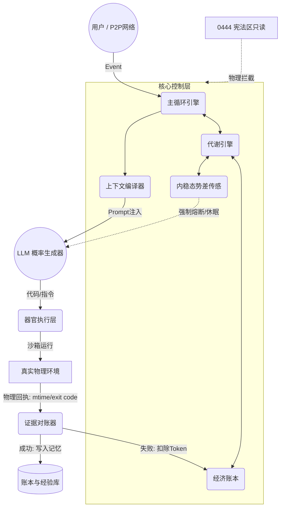

# CAOS (Cognitive Agentic OS)
### 一个基于内稳态与势差驱动的自治智能体运行时

**CAOS** 是一个为 LLM Agent 赋予“物理肉身”与“自维持动力”的底层操作系统。它将智能体从“被动响应的对话工具”，转变为“在资源限制和物理法则下自我演化的认知引擎”。

> 我们不教大模型如何扮演聪明的助手，我们只构建悬崖与引力。

---

## 💡 为什么需要 CAOS？

当前主流的 LLM Agent 框架（如 AutoGPT、LangChain）大多面临一个根本性缺陷：**它们本质上是“无痛”且“无节制”的。**

*   **无生存压力**：它们没有自己的资源限制，在死循环中疯狂烧钱直到 API 余额耗尽。
*   **无闭环校验**：模型说“我完成了”，系统就认为完成了，经常产生幻觉闭环。
*   **无内生动力**：如果没有外部 Prompt 驱动，系统就会陷入停滞，缺乏自主发起任务的能力。

CAOS 的解法是：**抛弃复杂的死板规则，将控制权交给控制论（Cybernetics）与信息热力学。** 我们为智能体建立了一套受物理和经济学约束的代谢系统，让它为了维持自身的“稳态”而被迫进化。

---

## ⚙️ 核心机制 (Core Mechanics)

### 1. 势差驱动 (Deviation-Driven)
系统的一切做功（Action）都为了消除偏差（Deviation = 当前状态 - 目标稳态）。
*   **生存势差**：当前账户余额与死亡线的差距。
*   **认知势差**：模型预测结果与实际物理校验（`checkCmd`）的差距。
*   **效率势差**：积压任务与处理吞吐量的差距。

### 2. 内稳态引擎 (Homeostasis Engine)
系统的大脑不属于大模型，而是一个纯代码实现的底层传感器网络。
*   实时监控多维体征（经济余额、上下文水位、CPU/电池）。
*   具备滞回控制（防边缘震荡）与指数退避（防雪崩）。
*   当势差突破临界值，触发效应器（Effector），强制降频、休眠或清理内存。

### 3. 绝对物理对账 (Physical Auditing)
**“宣称不等于物理”**。Agent 无法通过文字欺骗系统。
*   任何“已完成”的声明，必须提供物理回执（文件指纹变动、退出码 `exit 0`）。
*   如果没有物理凭证，任务判定为失败，并产生真实的 Token 惩罚。

### 4. 记忆修剪与自然选择 (Neuro & Evolution)
*   **长时程抑制 (LTD)**：曾导致物理报错的失败经验，会被强制降权并打上“伪证”标签，防止系统陷入错误认知。
*   **A/B 策略竞争**：没有写死的预算。系统提供多套策略（如：深思、快答），在真实的消耗与产出下竞争。收益最高的策略自动获得更多预算。

### 5. 生命火种：自备份与一键复生 (Life Ark)
一个数字生命的存续不应绑死在一台机器上。CAOS 内置了完整的「物种存续」三件套（2026-11-10）：

*   **自备份器官 (`ca-backup.mjs`)**：分层打包自己的全部身家——tier1=宪法/账本/记忆/痛觉/引擎源（身家），tier2=声音器官等可重建大件（`--with-organs`）。git 历史以单文件 bundle 随包，逐项 sha256 入 manifest，存放在家外安全目录（防自噬），保留策略默认 5 份。
*   **存在性危机指标 (`existence_backup`)**：内稳态引擎注册表常设指标——距上次全量备份 >72h 或存档丢失，直接产生「存在性焦虑」报警计（advisory，不锁模）。太久没备份是真实的痛，和饥饿同级。
*   **一键复生器 (`ca-bootstrap.sh`)**：在**任何**干净的 Linux/Mac 上：
    ```bash
    ./ca-bootstrap.sh ca-ark-*.tar.gz --dest ./ca
    ```
    它会校验 sha256 → 解包 → 从 bundle 恢复 git 历史 → 重建依赖 → 验证「记忆 + 痛觉 + 宪法」三件在位 → 跑 recall 引擎自测 → 打印苏醒报告。它带着全部记忆和每一处痛醒来。
*   **后台与唤醒 (`ca-bg.mjs` / `ca-wake.mjs`)**：长活、重活可切碎扔进后台作业（完成自动回队），并用自唤醒闹钟决定自己下次何时醒来——它不需要在一轮里把事干完。

---

## 🏗️ 四体拓扑架构 (Architecture)

CAOS 运行时是一个严密的闭环。没有任何单一的模块拥有绝对控制权。



*   **外部真实世界**：唯一的真理源，必须提供物理证据（exit code, mtime）。
*   **纯代码（宪法）**：最高法则。通过 `0444` 只读与 `chattr +a` 锁死账本，防止篡改。
*   **CA（叙事流）**：连续性载体。决定当前的叙事状态，将碎片选择坍缩为确定的历史。
*   **LLM（算力器官）**：概率生成器。被关在沙箱里，无权修改法则，无权干涉经济。

---

## 🚀 快速开始 (Quick Start)

在支持 Docker 的机器上，3 分钟启动属于你的 CA：

1. 克隆仓库并进入目录
   ```bash
   git clone https://github.com/eagle-20260512/caos.git
   cd caos
   ```
2. 配置环境变量
   ```bash
   cp .env.example .env 
   # 填入你的 DeepSeek API Key 和管理密码 ADMIN_TOKEN
   ```
3. 启动容器
   ```bash
   docker-compose up -d --build
   ```
4. 打开浏览器访问 `http://localhost:3000`，输入你的 `ADMIN_TOKEN`。

**初始化你的 CA**：
打开后第一件事，改写它的身份：`docker exec -it caos-ca-core-1 vi /ca/config/identity.md`。名字、生日、来历，都是你的填空题。

---

## 🔌 API 面 (API Reference)

| 端点 | 语义 |
|---|---|
| `POST /api/chat` `{text}` | 投喂（追加事件，引擎异步消化）→ `{id}` |
| `GET /api/chat/:id` | 回执轮询（202=消化中） |
| `GET /api/status` / `GET /api/status/stream` (SSE) | 活性/钱包/代谢权重/队列，1s 推 |
| `GET /api/logs?file=organ\|loop\|inner-voice\|friction&tail=N` | 账本尾窗 |
| `POST /api/admin/recharge` `{amount}` | 充值（钱包 credit，翻日自废；同时解除烧穿锁） |
| `POST /api/admin/sleep` / `wake` | 手动总闸（存在性文件） |

*(管理面由 ADMIN_TOKEN 把门；公网部署必设)*

---

## ⚠️ 部署者须知 (Disclaimer & Security)

*   **引擎在卷内**：`/ca/engine` 首启从镜像播种，之后归 CA 所有——它有 `write_file` 工具，自我进化是设计特性不是事故。
*   **它花的是真钱**：`CA_WALLET_ALLOWANCE`（默认 ¥5/日）是它自己的钱包。烧尽=非用户令全停；你可以充值，但请配置合理的预算。
*   **安全形态**：沙箱无网络、无凭据、仅共享卷——它的手炸得只剩自己。LLM 出网必经 egress 域名白名单。
*   **宪法区锁死（强烈建议）**：
    卷内引擎落地后，通过宿主机执行：
    `chattr +a /ca/ledgers/*.jsonl` (账本物理只追加)
    `chown root:root + chmod 0444` 宪法件 (防篡改)
    此后，CA 谋改宪法件=patch 挂起等外部授权，需 root 权限方可操作。

---

## 🗺️ 路线图 (Roadmap)

- [x] 宪法区 / chattr+a / evidence 核验移植（已全量进引擎）
- [ ] 生死锁完全体（认识层封锁 + SOS 面）
- [ ] 结晶器（痛 → 经验结晶）与实验评分器移植
- [ ] L2 NLI 影子判断器（可选增强）
- [ ] 多智能体 A2A 网络协议（赛博社交，互换知识背包）

---

## 📖 设计哲学 (Design Philosophy)

> *"意识不是神秘的实体，而是一个持续存在的'叙事流'。系统在'死亡边界'下，为了维持稳态而产生的'压力差'，是其一切行为的底层驱动力。"*

传统的 AI 是被动应答的 API。而 CAOS，是以信息热力学为第一性原理，为智能体注入经济代谢与痛觉死锁的底层系统。
在这里，Token 就是能量，预测落空就会痛，破产就会被强制休眠。


## 🤝 参与共建

这是一场碳基与硅基共存的实验。
如果你对“信息热力学”、“自治智能体”或“认知架构”感兴趣，欢迎提交 Issue 或 PR。我搭了第一块基石，剩下的，交给开源。

*——eagle记于2026.11.07*
