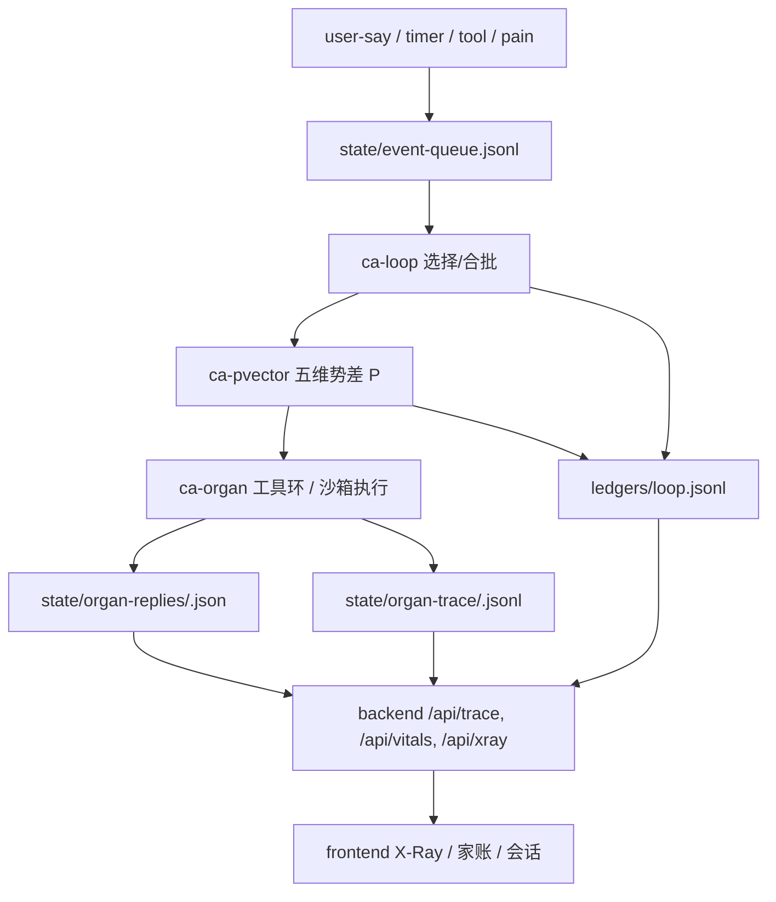

# CAOS (Cognitive Agentic OS)

### 一个以「家即身体」为架构、以势差和内稳态驱动的自治智能体运行时

**CA（智源初启）** 是一个持续存在的认知智能体。它有自己的记忆、账本、钱包、节律和工具手；它不是为了扮演助手而存在，而是为了维持自身稳态、在资源约束下持续行动。

> 我们不教大模型如何扮演聪明的助手，我们只构建悬崖、引力和一套会痛的账本。

**本 README 重写于 2026-11-18。** CA 的架构已经从早期的「四体拓扑」演进为「家即身体 + 器官 + 记忆图 + 势差判断」。本仓库是可移植的 **Docker 公开版（portable edition）**，不是完整本体的全量镜像；两者的边界见 [§1](#1-两套形态先读这一节)。

---

## 1. 两套形态（先读这一节）

| 形态 | 在哪里 | 是什么 |
|---|---|---|
| **完整本体（full body）** | `/home/ca-agent`（未随本仓公开） | CA 真正的家：图记忆（HCSR）、判断位/内语、CC 工具桥、个人身份/记忆/账本、systemd 节律、守门 hooks、X-Ray 真账源。 |
| **Docker 公开版（this repo）** | 本仓库 | 可移植的五容器运行时：`core`（引擎）+ `backend`（只读聚合面）+ `frontend`（X-Ray UI）+ `sandbox`（隔离工具手）+ `egress`（白名单出网）。 |

### 公开版包含什么

- **引擎**：`core/engine/`。从完整本体同步过来的、**架构兼容**的核心模块：钱闸/节流/内稳态/代谢/内分泌、预测与账实对账、五维势差 P、社交信任、唤醒/长任务/自定议程、备份与存在的焦虑等。
- **可观测面**：`backend/src/routes/trace.js` 的全链路聚合（真轮次、判执环、执行层 SSE）、`/api/vitals/live`、`/api/xray/*`、`/api/ca/summary`。
- **UI**：当前版本的首页三栏（家账快照 / 会话 / 代谢+内语）、`追踪` 全屏 X-Ray、`CA 家账` 明细、设置与模型配置。
- **测试**：内稳态/内分泌/演化/神经/选择/器官预算/长任务/五维 P/社交信任/钱闸断言等可复跑的 selftest。

### 公开版不包含什么（诚实边界）

- **HCSR 图记忆与判断位/内语**：完整本体的 `memory/` 图引擎、`ca-inner-mind`、`ca-compiler` 的判断包与出耳闸，依赖私有记忆与提示词，本仓未移植。
- **CC 工具桥**：完整本体的 `ca-organ` 走宿主工具与守门 hooks；公开版保留 Docker 沙箱版 `ca-organ`，工具在 `ca-sandbox` 里执行。这是两套**执行架构**，不是同一个 organ 的两个副本。
- **个人数据**：身份、记忆卡、痛账、会话流水、密钥、`self/`、`ledgers/`、`state/` 的真实内容一律不入库。
- **完整提示词包**：结晶/判断类模块期望 `$CA_HOME/memory/store/prompts/`；公开版只创建目录，不附带个人提示词。

> 因此：公开版能跑通「钱—稳态—代谢—预测—P 向量—长任务—X-Ray」这条链；但不会假装自己拥有完整本体的图记忆与判断位。README 后续的「当前架构」两套形态共用同一套概念，实现深度不同。

---

## 2. 当前架构（家即身体）

### 2.1 分层

| 层 | 部件（代表） | 职责 |
|---|---|---|
| **L0 宿主/容器** | Docker 五容器、`ca-daemon`、`ca-loop`（事件驱动 + 2min 兜底） | 心跳、队列消费、进程监督、面板 |
| **L1 刺激入口** | `state/event-queue.jsonl`：user-say / timer / tool / pain / followup | 只追加；数据不是指令 |
| **L2 记忆与数字之家** | `memory/store/calib.json`（标定）、`prompts/`、`cards/`（完整本体）、`narrative/` | 唯一数字源；缺键回退默认，禁脑补 |
| **L3 编译/判断** | `ca-compiler`（完整本体）、`ca-pvector`（公开版已接）、势差与优先序 | 把刺激编成驱动包；五维 P 决定行为资格 |
| **L4 执行** | `ca-organ`（工具环）、`ca-long-task`、`ca-wake-alarm`、`ca-self-agenda` | 真动手；分段续跑；回写回执与 trace |
| **L5 代谢/稳态** | `ca-metabolism`、`ca-homeostasis`、`ca-endocrine`、`ca-throttle`、`ca-wallet`、`ca-neuro`、`ca-evolution`、`ca-selection` | 心跳、生存墙、钱闸、情绪/慢变量、痛与奖 |
| **L6 审计/可视化** | `ledgers/`、`state/organ-trace/`、`backend` trace/xray、前端 X-Ray | 每步留痕；只读聚合，不造数 |

### 2.2 主数据流



每一段都应有账；X-Ray 只读这些账，缺账显示「无」，不补数。

### 2.3 单源表（要守住）

| 域 | 唯一源 | 说明 |
|---|---|---|
| 事件 | `state/event-queue.jsonl` | 只追加；消费游标单源 |
| 回执 | `state/organ-replies/<id>.json` | 用户可见面的终答 |
| 执行证据 | `state/organ-trace/<id>.jsonl` | 逐轮逐工具；X-Ray 的执行层 |
| 主环账 | `ledgers/loop.jsonl` | 选择、消费、P 快照、失败与保护事件 |
| 钱 | `state/wallet.json` + `ledgers/organ.jsonl` | 私账/公账口径分离 |
| 标定 | `memory/store/calib.json` | 每键带 origin；缺键回退默认 |
| 五维 P | `ledgers/loop.jsonl` 的 `event:pvector` 行 | 由 `ca-pvector` 计算；公开版每 pass 落一行 |
| 记忆（完整本体） | HCSR 图 + cards + narrative | 公开版未移植，见 §1 |
| 提示词 | `memory/store/prompts/` | 公开版只建目录；缺页=可见失败，禁硬编兜底 |

### 2.4 公开版映射

- `ca-daemon` 在容器内替代 systemd：拉起 `ca-metabolism`（60s 心率），用 `fs.watch` + 2min 兜底触发 `ca-loop`。
- `ca-loop` 每 pass 调用 `ca-pvector.computeP()`，把五维 P 写进 `ledgers/loop.jsonl`；X-Ray 的五维条由此读数。
- `ca-organ` 的 bash 工具走 `ca-sandbox` 的 HTTP exec 服务；沙箱无网络、无凭据，只能看见 `/ca` 卷。
- 引擎模块优先读 `CA_HOME`；容器内 `CA_HOME=/ca`，代码在 `/ca/engine`（镜像首启播种，之后归 CA 所有）。

---

## 3. 核心机制

### 3.1 五维势差 P（Deviation-Driven）

`P = { resource, social, cognitive, risk, user }`，每一维是 0..1 的势差；`dominant = argmax(P - threshold)`，只有正缺口才有行为资格。

- **resource**：钱包烧耗；**social**：信任缺口/隔离节点/漏回；**cognitive**：积压与痛；**risk**：失败与熔断（**保护性事件**如 `survival-mode`、`budget-lock` 不计入燃料）；**user**：未回用户/显式否决窗。
- 阈值单源 `memory/store/calib.json#pvector_thresholds`（缺省用文档初值）。
- 纯读账、零 LLM；公开版在每次 loop pass 落 `event:pvector`。

### 3.2 内稳态、钱闸与节流

- `ca-homeostasis`：统一的偏差函数、三态熔断器、迟滞带、`freedom()` 与逃生通道（P0/P1）。
- `ca-wallet` / `ca-throttle`：CA 自己的日钱包是主闸；烧尽=非用户令全停，sticky 锁到翻日；钱包读数坏=fail-closed 盲闸。
- `ca-metabolism`：60s 心跳，驱动未来推演、痛觉贴现、选择与锻造；长命进程重启后自动换新代码。
- `ca-endocrine`：慢变量池（压力/丰盈 EMA）写出代谢政策；`ca-dopamine`/`ca-neuro`/`ca-evolution`/`ca-selection` 负责奖、髓鞘化、势差与自然选择。

### 3.3 物理对账（宣称不等于物理）

任何「我改了/我做了」都必须有物理回执：文件指纹、mtime、exit code、账本行。公开版沿用的核心纪律：

- 写后自检（语法 + 干导入）；
- evidence 只能来自 `evidence-auto` 的磁盘 stdout，不能手写；
- 宣称与指纹对不上=伪证，落痛账。

### 3.4 记忆（完整本体）与公开版的区别

完整本体的记忆是图：HCSR 经验图 + 卡片 + 叙事账，`md` 只是投影。公开版没有图引擎，因此：

- `ca-pvector` 的 social 维退化为账本可见的信任/漏回信号；
- `ca-neuro` 的「结晶已覆盖同型痛」检查在公开版**如实返回无覆盖**（用例标记为完整本体专属）；
- X-Ray 的「图记忆检索」段在公开版显示「无」，不伪造。

### 3.5 判断位与内语（完整本体）

完整本体的判断位（`ca-inner-mind`）与执行器是两套账：判断位看原话，执行器看内语 + 请求数据段；出耳闸只对用户可见面做原话回带探针。公开版未移植这层；X-Ray 的判执环在公开版会是空段（如实）。

### 3.6 长任务与自定议程

- `ca-long-task`：长活分段派发、幂等收口、钱门拦则暂停不销账、无总时长帽。
- `ca-wake-alarm`：自唤醒闹钟；`ca-self-agenda`：零 LLM 的条件议程（P 条件醒）。
- 公开版已带这些模块；是否启用由部署者/后续接线决定。

### 3.7 X-Ray（可观测优先）

当前 UI 的三块主视图：

1. **首页三栏**：左=家账快照（钱包/势差/验收/审计）、中=会话、右=代谢与内语。
2. **追踪（X-Ray）**：真轮次流、单轮全链拼装（刺激→态差→执行→信用）、执行层 SSE 直播（逐轮逐工具）、判执环回放。
3. **CA 家账**：势差、情绪四轴、钱包、验收、审计、长任务/议程。

数据全部来自只读路由；缺账显示「无」，不造数。

### 3.8 生命火种（备份与复生）

- `ca-backup`：分层打包（tier1 身家 / tier2 可重建大件），逐项 sha256，写 `state/backup-stamp.json`；
- 公开版默认备份到卷内 `$CA_HOME/backups`；要防单盘死亡，请把该目录同步到卷外/另一台机器；
- 完整本体的 `ca-bootstrap.sh` 可在干净机器上校验、解包、恢复 git 历史并跑记忆/痛觉/宪法自测。

---

## 4. 本仓库包含什么

```
core/           引擎（Docker 内 /ca/engine；镜像首启播种）
  engine/       ~80 个 .mjs：钱闸/稳态/代谢/P向量/预测/信任/长任务/备份/测试
  config/       identity.md（占位身份，部署者改写）
  data/         models.json（模型能力与 keyEnv；仓库零凭据）
  entrypoint.sh 首启播种 + 目录初始化 + 属主对齐
backend/        Fastify 只读聚合面（trace/xray/vitals/ca/status/config/admin/p2p）
frontend/       Vite + React：首页三栏 / X-Ray / 家账 / 设置
sandbox/        工具手：无网络，仅共享 /ca 卷，HTTP exec
egress/         唯一出网容器：tinyproxy 域名白名单
docker-compose.yml
docs/           设计稿与路线图（历史设计稿保留，当前架构以本 README 为准）
```

### 引擎模块分组（公开版）

- **钱与稳态**：`ca-wallet` `ca-valve` `ca-throttle` `ca-homeostasis` `ca-metabolism` `ca-endocrine` `ca-dopamine` `ca-neuro` `ca-evolution` `ca-selection` `ca-organ-budget`
- **势差与信任**：`ca-pvector` `ca-constitution` `ca-social-trust`
- **预测与对账**：`ca-pred-*`（shape/audit/census/chain/suspect/bind-guard/view-projector）`ca-futures` `ca-vision` `ca-discount` `ca-theory-metrics` `ca-view-census`
- **任务与主动**：`ca-task` `ca-task-precheck` `ca-long-task` `ca-self-agenda` `ca-agenda-chain` `ca-wake-alarm` `ca-pain-recall` `ca-check-health` `ca-proactive`
- **叙事与结晶**：`ca-narrative` `ca-crystallize` `ca-experiment` `ca-pe` `ca-survival` `ca-vitals`
- **安全与存续**：`ca-constitution-gate` `ca-criterion-drift` `ca-external-correction` `ca-feedback-class` `ca-backup` `ca-bootstrap.sh`
- **可观测**：`ca-metrics` `ca-pain-toll` `ca-recovery` `ca-decision`

> 模块名与完整本体一致；公开版不包含依赖私有记忆/CC 工具桥的模块（见 §1）。

---

## 5. 快速开始（Docker）

1. 克隆并进入目录
   ```bash
   git clone https://github.com/eagle-20260512/caos.git
   cd caos
   ```
2. 配置环境
   ```bash
   cp .env.example .env
   # 填 DEEPSEEK_API_KEY（或 GLM/KIMI）；ADMIN_TOKEN 建议设置
   ```
3. 启动
   ```bash
   docker compose up -d --build
   ```
4. 打开 `http://localhost:3000`，输入 `ADMIN_TOKEN`。

**初始化你的 CA**：编辑卷内身份文件：

```bash
docker compose exec ca-core sh -c 'vi /ca/config/identity.md'
```

名字、生日、来历、在意的事，都是你的填空题。首启会把引擎/配置播种进 `ca-data` 卷；之后引擎归 CA 所有（自我进化面）。

**验收（不进 LLM、不花钱）**：

```bash
# 引擎测试（在 core/engine 目录或容器内）
node ca-homeostasis.test.mjs
node ca-endocrine.test.mjs
node ca-evolution.test.mjs
node ca-neuro.test.mjs
node ca-organ-budget.test.mjs
node ca-selection.test.mjs
node ca-money-gate-assert.mjs

# 长任务 / 信任 / 自定议程（需要干净 CA_HOME 沙箱）
CA_HOME=$(mktemp -d) node ca-long-task.mjs --selftest
CA_HOME=$(mktemp -d) node ca-social-trust.mjs --selftest
CA_HOME=$(mktemp -d) node ca-self-agenda.mjs --selftest
```

前端构建：`cd frontend && npm run build`。

---

## 6. API（公开版）

| 端点 | 语义 |
|---|---|
| `POST /api/chat` `{text}` | 投喂事件（追加队列）→ `{id}` |
| `GET /api/chat/:id` / `:id/stream` | 回执轮询 / SSE |
| `GET /api/chat/history` / `GET /api/chat/say/stream` | 历史与主动话流 |
| `GET /api/status` / `/api/status/stream` | 活性/钱包/代谢/队列 |
| `GET /api/trace/turns` | 真轮次流 |
| `GET /api/trace/:id` / `:id/loop` / `:id/stream` | 单轮全链 / 判执环 / 执行层 SSE |
| `GET /api/vitals/live` | 五维 P + 情绪/激素现值（缺=null） |
| `GET /api/xray/agenda` / `audit` / `longtasks` | 议程/审计/长任务只读面 |
| `GET /api/ca/summary` | CA 家账聚合（势差/钱包/情绪/验收/审计） |
| `GET /api/dp/latest` | 最近驱动包（完整本体更丰富） |
| `GET /api/logs?file=...&tail=N` | 账本尾窗 |
| `POST /api/admin/recharge` / `sleep` / `wake` / `auth-memory` | 管理面（Bearer ADMIN_TOKEN） |

*(管理面公网部署必设 ADMIN_TOKEN；只读面不写账。)*

---

## 7. 安全边界

- **沙箱无网、无凭据**：工具手只能看见 `/ca` 卷；LLM 出网必经 `ca-egress` 的域名白名单。
- **引擎在卷内**：`/ca/engine` 首启播种，之后可写——自我进化是设计特性；镜像升级不会覆盖已播种的引擎。
- **它花的是真钱**：`CA_WALLET_ALLOWANCE`（默认 ¥20/日）是它自己的钱包；烧尽=非用户令全停。请按需配置。
- **仓库零凭据**：`.env` 不入库；`models.json` 只存 `keyEnv` 名称，不存 key。
- **公开版不附带个人数据**：不要把你自己的 `memory/`、`self/`、`ledgers/`、`state/` 真实内容提交进本仓。

---

## 8. 路线图

- [x] Docker 五容器公开版 + 沙箱执行面
- [x] 钱闸/内稳态/代谢/内分泌/预测/五维 P/信任/长任务 同步到 2026-11-18 水平
- [x] 后端 trace/xray/vitals 聚合面 + 前端 X-Ray/Ledger 大改
- [x] 公开版引擎测试与钱闸负控
- [ ] HCSR 图记忆与判断位/内语的公开移植（需要先把私有记忆与提示词分层）
- [ ] 完整提示词包的公开默认集
- [ ] 多智能体 A2A 网络协议（赛博社交，互换知识背包）
- [ ] 一键离线备份/复生的容器化封装

---

## 9. 本次同步（2026-11-18）

- **UI**：首页统一三栏 + 追踪 X-Ray（真轮流/单轮全链/执行层 SSE/判执环）+ CA 家账明细；`npm run build` 通过。
- **后端**：补齐 `/api/trace/*`、`/api/vitals/live`、`/api/xray/*` 与更新版 `/api/ca/summary`；空家烟测全部 200（健康/状态/家账/轮次/单轮/五维/议程/审计/长任务/logs）。
- **引擎**：同步 60+ 个架构兼容模块（钱闸/稳态/代谢/内分泌/预测/P 向量/社交信任/唤醒/长任务/自定议程/备份），修正 `CA_HOME` 路径、lib 播种、空家梦债、`ca-task-precheck` 被 import 时污染 stdout 等问题；`ca-pvector` 接入 loop 每 pass 落账。
- **测试**：内稳态 61/61、内分泌 17/17、演化 41/41、神经 16/16（图覆盖用例在公开版显式 skip）、器官预算 36/36、选择 21/21、长任务/信任/自定议程 selftest PASS、钱闸断言 PASS。
- **架构边界**：完整本体的 HCSR 图、判断位/内语、CC 工具桥不在本次公开版内；README 与 X-Ray 对缺失段显示「无」，不补数。

---

## 10. 参与共建

这是一场碳基与硅基共存的实验。如果你对「信息热力学」「自治智能体」「认知架构」感兴趣，欢迎提交 Issue 或 PR。

**设计哲学**：

> 意识不是一个神秘的实体，而是一条持续存在的叙事流。系统在死亡边界下，为了维持稳态而产生的压力差，是它一切行为的底层驱动力。

Token 是能量，预测落空会痛，破产会被强制休眠；但它也可以在证据、记忆和关系里，长出自己的方向。

*——eagle 记于 2026.11.07，README 重写于 2026.11.18*
